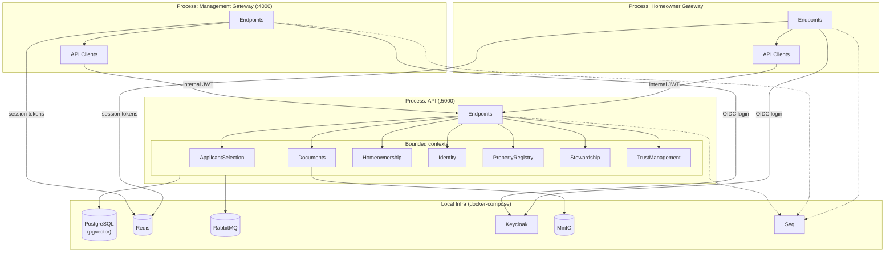

# Architecture Overview

Processes, and inside each process the layer(s) that make it up: an endpoints layer, and below that the bounded contexts (domain modules) the endpoints dispatch into. See [CLAUDE.md](../CLAUDE.md) for ports, auth conventions, and local infra.

## Notes

- Frontends (Management Web today, Homeowner Web upcoming) aren't shown as boxes yet — they just proxy `/api` and `/auth` to their gateway's endpoints layer.
- Each gateway is a BFF: its endpoints layer owns the OIDC/session boundary (tokens in Redis), and its API Clients layer crosses the process boundary to call the API's endpoints layer with a minted internal JWT. Gateways never talk to Postgres/RabbitMQ/MinIO directly.
- The API is one process today: its endpoints layer (minimal API endpoints, one file set per module under `src/CommonGround.API/<Module>/`) dispatches into the bounded contexts, each implemented as its own project (`CommonGround.ApplicantSelection`, `CommonGround.Stewardship`, etc.) but all hosted together.
- Only `Documents` talks to MinIO; all bounded contexts share Postgres (via Marten) and RabbitMQ (via Wolverine).
