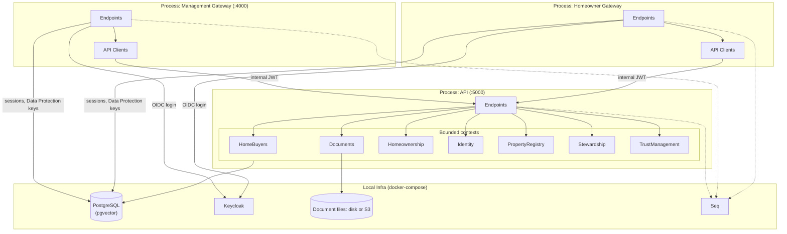

# Architecture Overview

Processes, and inside each process the layer(s) that make it up: an endpoints layer, and below that the bounded contexts (domain modules) the endpoints dispatch into. See [CLAUDE.md](../CLAUDE.md) for ports, auth conventions, and local infra.

## Notes

- Frontends (Management Web today, Homeowner Web upcoming) aren't shown as boxes yet — they just proxy `/api` and `/auth` to their gateway's endpoints layer.
- Each gateway is a BFF: its endpoints layer owns the OIDC/session boundary, and its API Clients layer crosses the process boundary to call the API's endpoints layer with a minted internal JWT. Each gateway keeps its sessions and its ASP.NET Data Protection keys in its own Postgres schema (`management_gateway`, `homeowner_gateway`) and reads no other data there; it never reads document files.
- The API is one process today: its endpoints layer (minimal API endpoints, one file set per module under `src/CommonGround.API/<Module>/`) dispatches into the bounded contexts, each implemented as its own project (`CommonGround.HomeBuyers`, `CommonGround.Stewardship`, etc.) but all hosted together.
- Only `Documents` reads and writes document files, through `IDocumentBlobStore`. `Documents:Store` picks the store: `FileSystem` (the default, a directory set by `Documents:FileSystem:RootPath`) or `S3` (settings under `Documents:S3`; MinIO in development). The S3 store redirects downloads to a presigned URL. With the file system store the API streams the file, and the gateway passes it on with `Content-Disposition`, `nosniff` and a `sandbox` CSP so an uploaded HTML or SVG file can't run script on the app's origin. All bounded contexts share Postgres through Marten. Wolverine delivers messages between them on durable local queues stored in Postgres.
- Integration events (types in the `.Events` namespace of a `*.Contracts` assembly) can also go to an external transport for a service split out of the API later. `Messaging:Transport` picks it: `None` (the default), `Postgres` (one queue, `Messaging:PostgresQueue`, default `integration_events`) or `RabbitMq` (one exchange per event type, settings under `Messaging:RabbitMq`). Handlers in the API receive the events with any setting.
