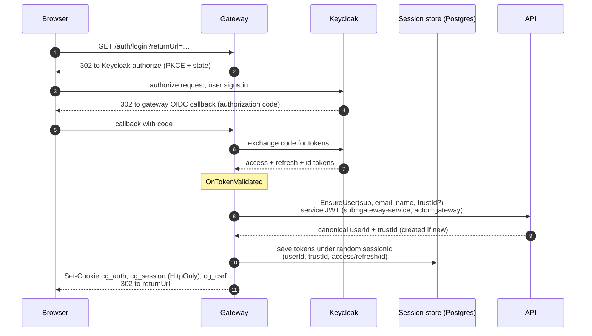
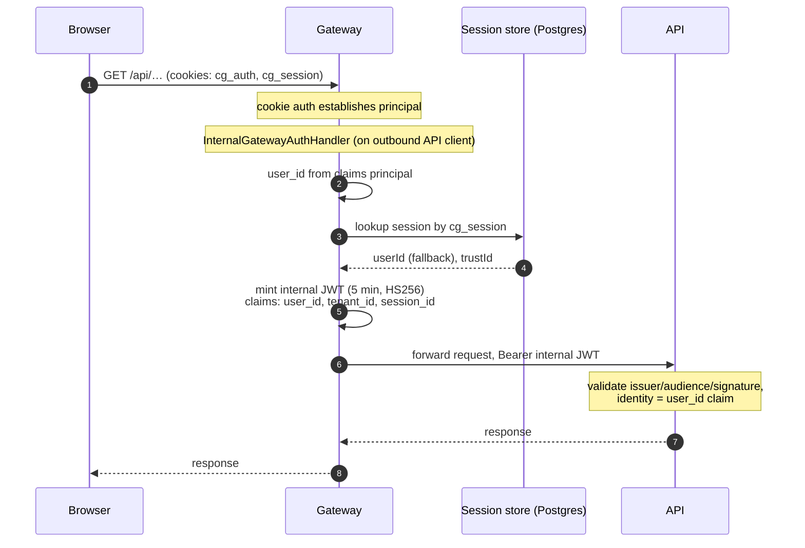
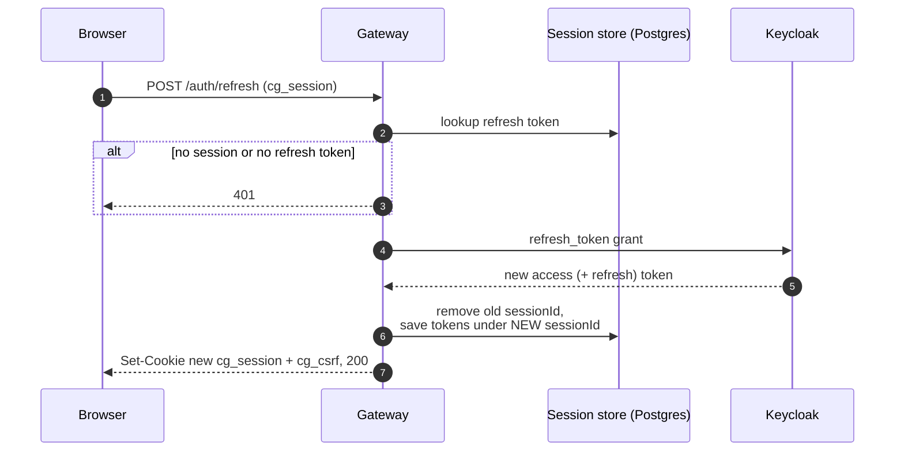

# Authentication Flow

How a user gets a session and how that session becomes an authenticated API call. Applies to the Management Gateway (:4000); the Homeowner Gateway follows the same pattern. Rendered viewer: [auth-flow.html](auth-flow.html).

Key facts:

- The gateway is the only OIDC client. The browser never talks to Keycloak directly except during the redirect dance, and Keycloak tokens never reach the browser or the API.
- Upstream tokens (access/refresh/id) live server-side in the gateway's `sessions` table in Postgres (7-day expiry, expired rows deleted hourly), keyed by a random session ID stored in the `cg_session` cookie (HttpOnly). `cg_csrf` is JS-readable for CSRF protection; `cg_auth` is the ASP.NET cookie-auth ticket.
- Every gateway→API call carries a freshly minted internal JWT (HS256, 5-minute lifetime, issuer `CommonGround.Gateway`, audience `CommonGround.API`). The API derives identity from its `user_id` claim; `tenant_id` carries the trust ID.

## Login

Note step 8: user provisioning is just-in-time — the gateway calls the API's `EnsureUser` during login using a *service* token (no `user_id` yet), and the API's canonical user ID is what goes into the session, not the Keycloak subject.

## Authenticated API call

The trust ID always comes from the session lookup, not from claims — a request with a valid `cg_auth` cookie but no session row gets a JWT without `tenant_id`.

## Token refresh

Refresh rotates the session ID: the old session row is deleted and new cookies are issued, so a captured `cg_session` value goes stale after the next refresh.

## Logout

No diagram — `GET /auth/logout` deletes the session row and the `cg_session`/`cg_csrf` cookies, then signs out of both the cookie scheme and Keycloak (passing the stored `id_token` as the logout hint).
